# Active Directory home lab — build and enumeration

I built a domain controller and an attacker workstation on an isolated virtual network, then worked
from *no credentials at all* to authenticated domain access — writing down what a domain controller
gives away at each step, and what it correctly refused to give up.

The interesting part is not that anonymous LDAP returns data. It is that a DC answers on six ports to
a stranger, hands over its own name and domain in a single unauthenticated query, accepts an SMB null
session, and then lets any domain user read the group policies that decide how every machine in the
domain is configured. Each of those is normal Windows behaviour. Together they are the first hour of a
real intrusion.

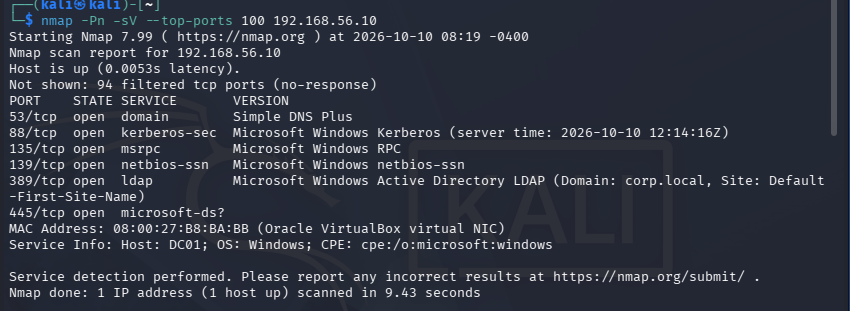

## Environment

| | |
|---|---|
| Hypervisor | VirtualBox, host-only network `192.168.56.0/24` |
| Domain controller | `DC01` — Windows Server 2025 (build 26100), `192.168.56.10` |
| Domain | `corp.local` (NetBIOS `CORP`) |
| Attacker | Kali Linux |
| Lab accounts | `ajohnson`, `mlee`, `tsmith` — throwaway passwords, lab only |
| Test date | 10 October 2026 |

Nothing here touches a real network: two VMs, both mine, sealed off from the physical LAN.

## What the lab found

| # | Observation | Evidence |
|---|---|---|
| 1 | Six services answering a stranger: DNS, Kerberos, RPC, NetBIOS, LDAP, SMB | `02` |
| 2 | 94 of 100 scanned ports filtered by the host firewall — the exposed surface is deliberate | `02` |
| 3 | Unauthenticated LDAP RootDSE read returns the DC hostname and the domain naming context | `04` |
| 4 | SMB null session accepted (`Null Auth: True`); shares enumerable without credentials | `21`, `22`, `05` |
| 5 | SMB signing enforced and SMBv1 absent — two real mitigations already in place | `21`, `06`, `07` |
| 6 | Domain users and groups enumerable after authenticating as an ordinary user | `24`–`28` |
| 7 | `Domain Admins` contains exactly one account: the built-in `Administrator` | `27` |
| 8 | No Kerberos delegation configured anywhere in the domain | `29` |
| 9 | SYSVOL readable by any authenticated user; `Registry.pol` extracted and the settings decoded | `30`–`34` |
| 10 | No AS-REP roastable accounts — all three users require Kerberos pre-authentication | `15` |
| 11 | A service account with an SPN (`svc_sql`, MSSQL on the DC) that has never logged on | `35`, `36` |
| 12 | Two Kerberos failures diagnosed and cleared: clock skew, then an unsupported etype | `35`, `36` |
| 13 | LDAPS probe never received a certificate — recorded as inconclusive, not as a finding | `19` |

Two companion pages: **[how to rebuild this lab](build/README.md)** (a provisioning script that re-creates
the four accounts and checks the posture it claims) and **[what this looks like to a defender](docs/attack-and-detection.md)**
(every step mapped to an ATT&CK technique, the Windows event it leaves, and the control that would
have stopped it).

## Walkthrough

### 1. Reconnaissance

```
nmap -Pn -sV --top-ports 100 192.168.56.10
```

Six ports open, everything else silent: `53`, `88`, `135`, `139`, `389`, `445`. OS fingerprint and the
service banner both name `DC01` and Windows, and the LDAP banner volunteers the domain and site
(`Domain: corp.local, Site: Default-First-Site-Name`) before I sent a single credential.

Note the `94 filtered` line. This isn't a hardened host — Windows Firewall is simply dropping the other
94 ports. Filtered is not the same as closed, and it is not the same as fixed.

### 2. DNS

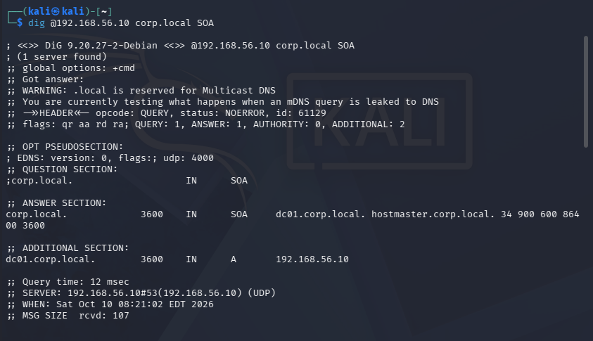

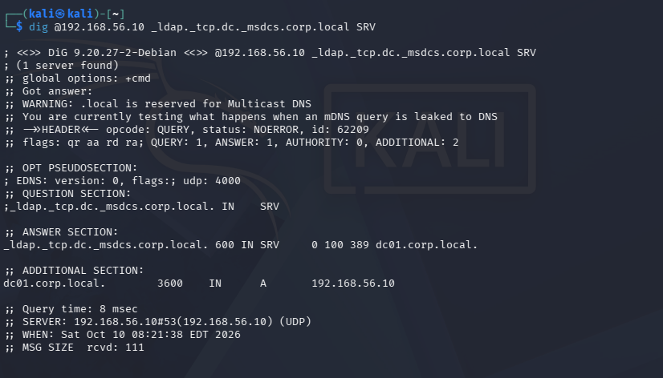

A domain controller is the DNS server for its domain, so querying it is free reconnaissance: the domain
name, the DC's own A record, and the service records that advertise Kerberos and LDAP all come back
without authentication.

### 3. LDAP without credentials

```
ldapsearch -x -H ldap://192.168.56.10 -s base -b "" "(objectClass=*)" defaultNamingContext
```

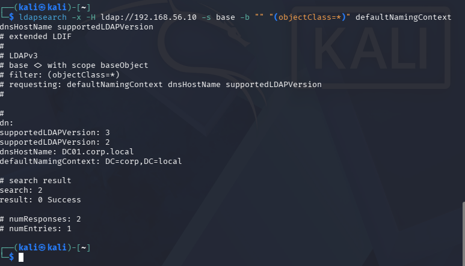

Unauthenticated, the DC still answers with `dnsHostName: DC01.corp.local` and
`defaultNamingContext: DC=corp,DC=local`. That is not a vulnerability — it is how clients discover the
directory — but it means an attacker's first query costs nothing and returns the exact naming context
every later query needs.

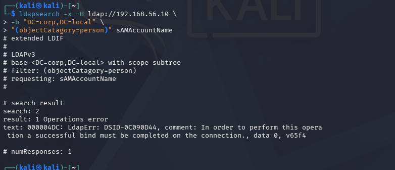

### 4. SMB without credentials

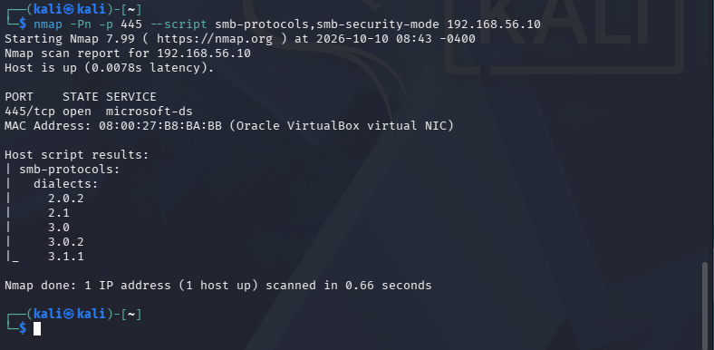

`nxc smb` against the DC reports what matters before a password is even tried:

```
SMB  192.168.56.10:445  DC01  [*] Windows 11 / Server 2025 Build 26100 x64 (name:DC01) (domain:corp.local) (signing:True) (SMBv1:None) (Null Auth:True)
```

Two of those are good news for the defender and one is not. **`signing:True`** shuts down SMB relay,
**`SMBv1:None`** removes a twenty-year-old attack surface, and **`Null Auth:True`** means the server
still accepts an anonymous session.

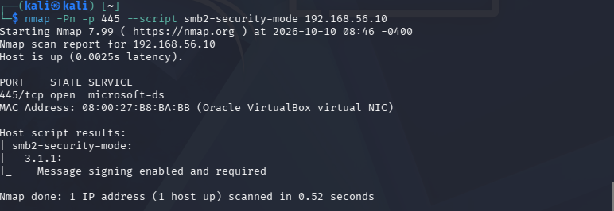

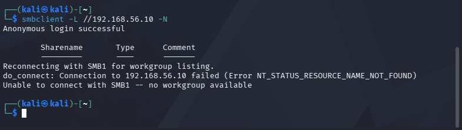

The null session is not a break-in. What it is: a way to enumerate shares and policy without ever
appearing as a failed logon, which is exactly the traffic the SIEM I later built is designed to catch.

### 5. Becoming a domain user

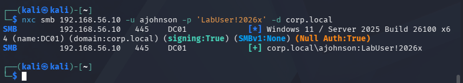

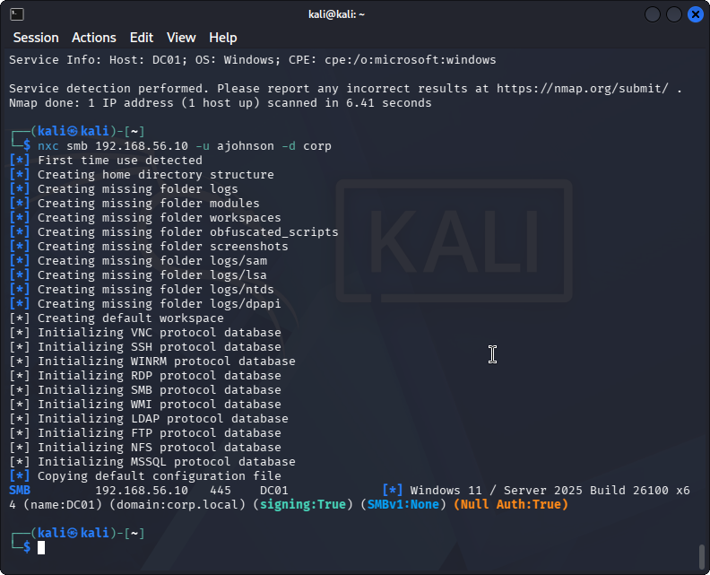

Once I had a normal, unprivileged domain account, the picture changed completely — and this is the step
worth explaining to a non-technical reader. In Active Directory, *having any account* is the door.
Authorisation is what's behind it, and most of the directory is readable to every employee by design,
because that is how Outlook finds your colleagues.

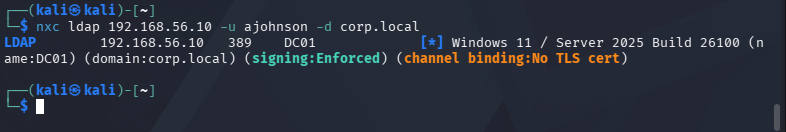

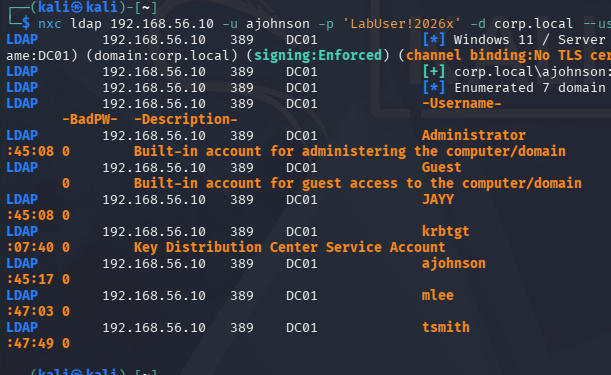

### 6. Groups, privilege, and delegation

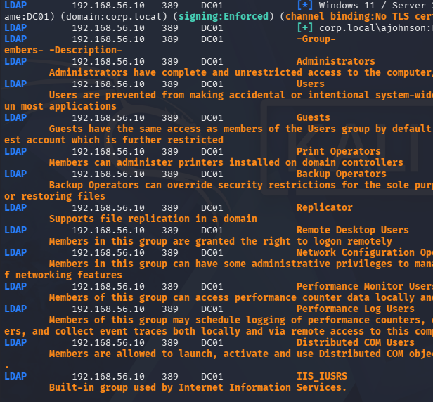

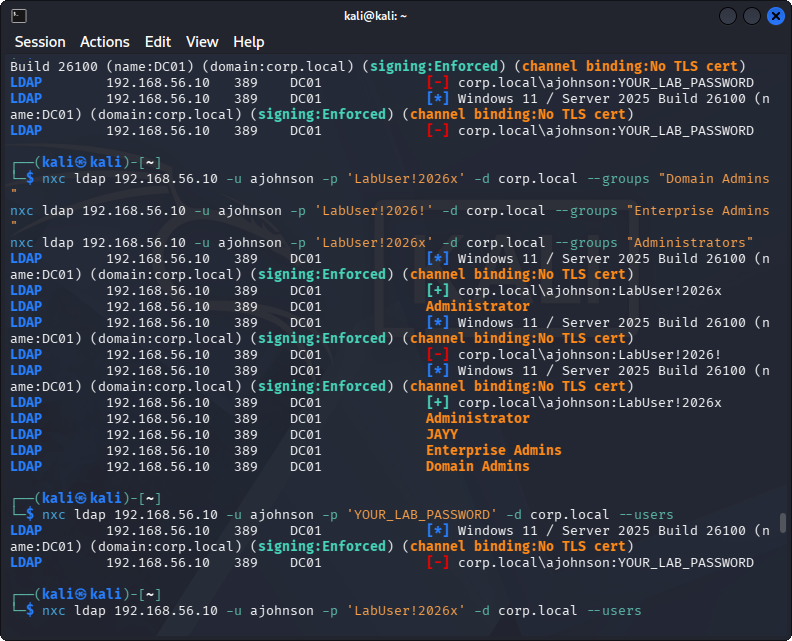

```
nxc ldap 192.168.56.10 -u ajohnson -p '…' -d corp.local --groups "Domain Admins"
```

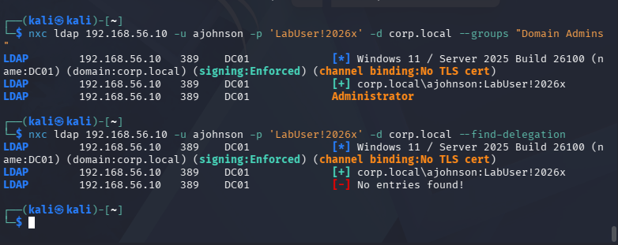

The answer is a single line — `Administrator` — which is the answer you want. A newly built domain where
the only domain admin is the built-in account is a domain with no privilege sprawl to clean up. This is
also the query I would run first on a real engagement, because group membership *is* the privilege map.

```
nxc ldap 192.168.56.10 … --find-delegation
```

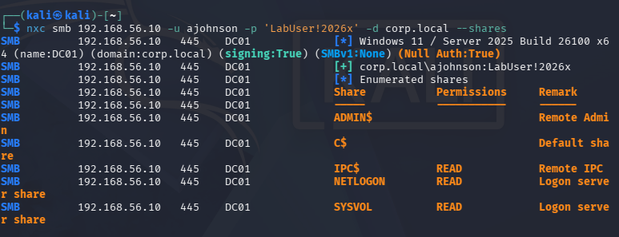

`No entries found!` — no unconstrained delegation, the misconfiguration behind most Kerberos
impersonation paths. Absence of a finding is still a result, and reporting it is the difference between
"found nothing" and "checked and it's not there".

### 7. SYSVOL and group policy

```
smbclient //192.168.56.10/SYSVOL -U 'CORP/ajohnson' -m SMB3
```

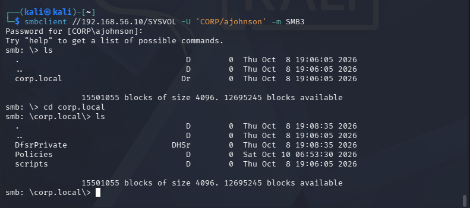

Any authenticated user can read `SYSVOL`, because domain machines and users need to fetch their policy.
Inside it: `corp.local/Policies` — every GPO in the domain, one directory per policy.

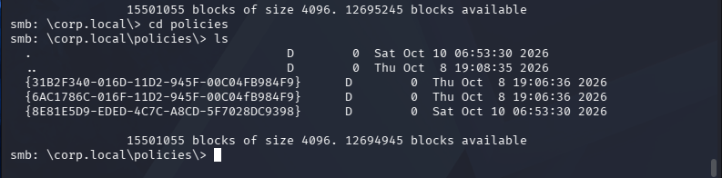

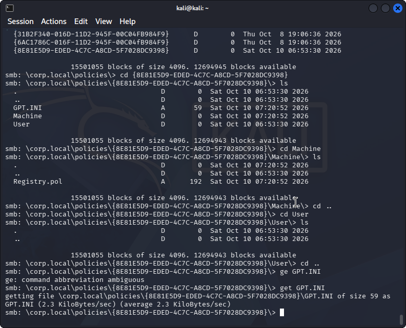

I pulled one policy's `Registry.pol` out and read it locally.

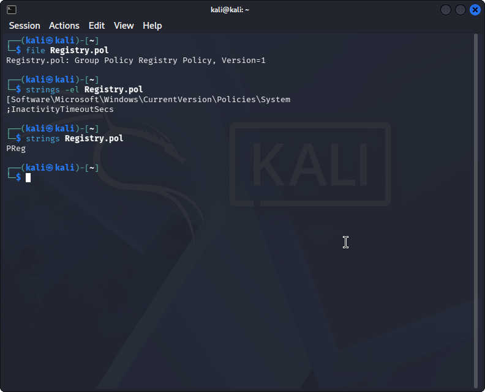

```
$ file Registry.pol
Registry.pol: Group Policy Registry Policy, Version=1
$ strings -el Registry.pol
[Software\Microsoft\Windows\CurrentVersion\Policies\System];InactivityTimeoutSecs
```

A registry policy is a documented binary format, not an encrypted one: `strings` alone recovers the
setting, and `xxd` shows the record structure if you want the value itself.

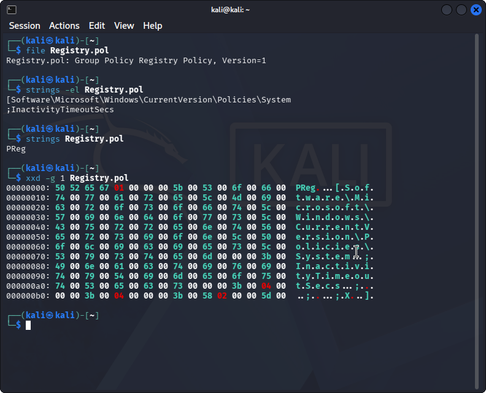

Here it discloses the workstation inactivity timeout — an attacker reads that and learns how long a
locked, unattended session stays authenticated. The more famous consequence of a world-readable SYSVOL
is a `Groups.xml` with a `cpassword` from a preference-based drive mapping; the encryption on that field
is a published key, so it is not encryption at all. I did not create that condition in my lab, so I won't
claim I found one. What I can show is the path: read SYSVOL, list policies, decode a policy.

### 8. Kerberos

First question: is anyone roastable without a password?

```
impacket-GetNPUsers corp.local/ -usersfile lab-users.txt -dc-ip 192.168.56.10 -no-pass
```

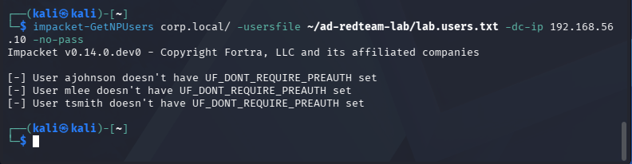

All three users have pre-authentication required, so there is no AS-REP hash to crack. Correct default
behaviour, and worth recording as such.

Second question: are any service accounts kerberoastable?

```
impacket-GetUserSPNs corp.local/ajohnson:'…' -dc-ip 192.168.56.10 -request
```

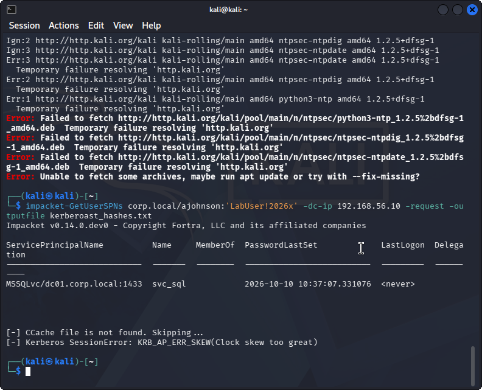

This failed the first time with `KRB_AP_ERR_SKEW (Clock skew too great)`. Kerberos rejects tickets from
a clock more than five minutes out of step with the KDC — my Kali VM had drifted. Wrong clock, no
Kerberos, and the error a beginner sees looks nothing like "set your time".

After syncing against the DC, the same query returned the SPN table:

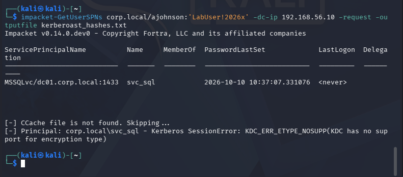

One service account, `svc_sql`, holds `MSSQLSvc/dc01.corp.local:1433`, with its password last set when
the service was installed and **no last logon recorded at all**. That is the profile of a crackable
service account: a password set once and never rotated, and an SPN that lets any domain user request a
ticket for it.

Then the second wall: `KDC_ERR_ETYPE_NOSUPP (KDC has no support for encryption type)` when requesting
the ticket. The domain refused to hand out an RC4 ticket for that account, so I could prove the account
is roastable in principle but could not capture a hash to crack. Recording that distinction — *exposed,
not yet exploited* — is more honest than writing "kerberoasted" in a report.

### 9. LDAPS and the certificate

```
nmap -p 636,3268 192.168.56.10
openssl s_client -connect 192.168.56.10:636 -showcerts
```

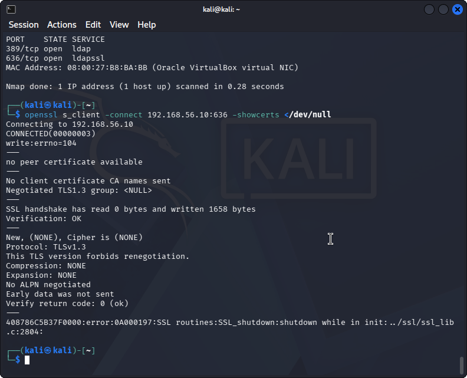

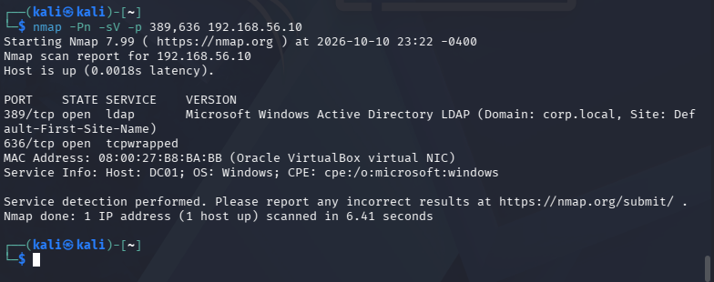

The port answered, but `openssl s_client` never received a peer certificate — TLS 1.3 negotiated no
cipher and the server reset the connection (`write:errno=104`).

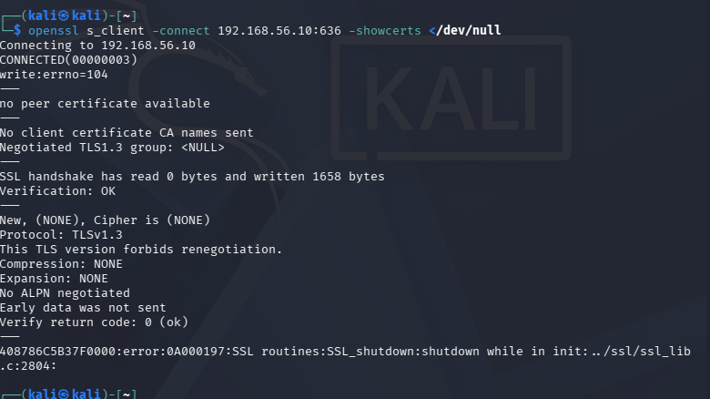

I left this on the record as **inconclusive**. A certificate I could not retrieve is not a finding about
the certificate, and guessing what it would have said is how a report loses credibility.

## What the defender should take from this

1. **Assume the directory is readable.** Anonymous RootDSE plus one ordinary account gave me users,
   groups, policy and service principals. Design as if an attacker already has a standard account,
   because eventually one will.
2. **The firewall is doing the hardening, not the host.** Six ports open is normal for a DC; 94 filtered
   means someone remembered the firewall. Neither is a substitute for patching and tiered admin.
3. **Watch the quiet enumeration.** The loudest thing in this entire lab was a failed Kerberos attempt.
   Everything that mattered — LDAP queries, SYSVOL reads, share listings — looks like normal traffic.
   That is precisely why I built `logtriage`.
4. **Audit service accounts with SPNs.** `svc_sql` is not compromised, but a never-logged-on account
   with a set-once password and an SPN is exactly what gets cracked first.
5. **SYSVOL is a credential store if anyone puts credentials in it.** Reading it is normal; a
   `cpassword` sitting in a policy is not.

## What I'd do next

- Try a delegated (constrained) setup, so I can practise abusing it instead of only proving its absence.
- Enable AES-only Kerberos deliberately and confirm which etypes the KDC offers — that `ETYPE_NOSUPP`
  deserves a proper explanation rather than a shrug.
- Add a Windows event parser to `logtriage` for `4768`/`4769`/`4771`/`5145`. Right now none of this
  enumeration appears in my own detection tool, which is a scope gap rather than a mystery — the rules
  are written in the [detection notes](docs/attack-and-detection.md), waiting for an engine.
- Finish the LDAPS question with a CA-issued certificate instead of the self-signed default.

## Honest limits

No password guessing, no spraying, no exploitation, no persistence, no lateral movement — this lab stops
at enumeration by design. The environment is one DC and one workstation; there is no trust relationship,
no second domain, and no Exchange or SQL server to pivot through. The credentials visible in the
screenshots belong to throwaway lab accounts and the environment has since been rebuilt.

`lab-users.txt` is the three-account wordlist used for the AS-REP check — that's all it is.

## Contents

```
build/         New-LabEnvironment.ps1 (idempotent rebuild) + the build runbook
docs/          ATT&CK mapping, Windows event IDs and detection logic per step
screenshots/   every step, in order (29 images)
lab-users.txt  the three lab accounts used for the pre-auth check
LICENSE        MIT
```

MIT licensed. The writeup is mine; the tools are other people's (nmap, Impacket, NetExec, smbclient),
used within their licences.
